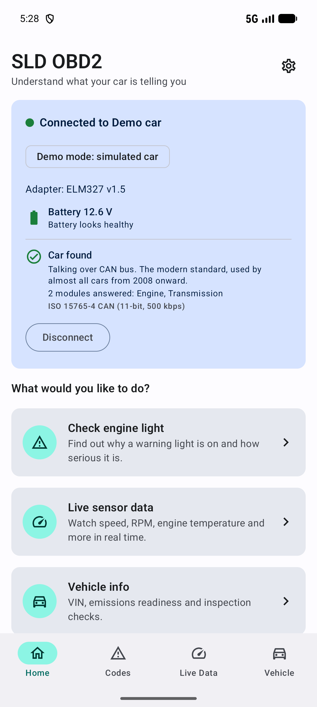
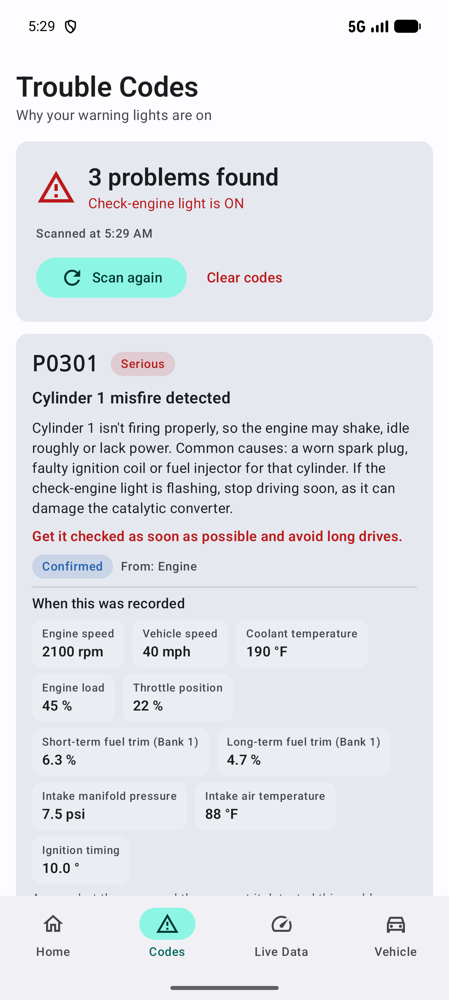
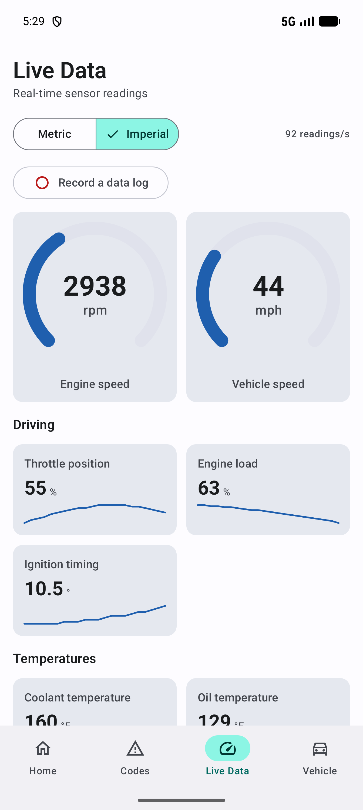
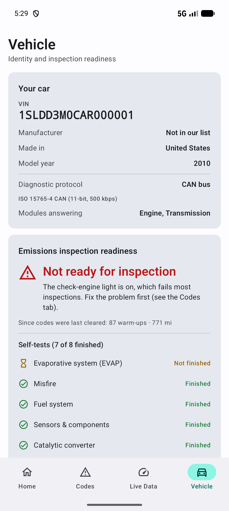

# SLD OBD2

**An ad-free OBD2 car diagnostics app for Android that explains what your car is telling you — in plain English.**

Plug a cheap OBD2 adapter into your car, connect your phone, and find out why a warning light is on, how serious it is, and what to do next. No account, no ads, no tracking.

  
  
  
  

## Download

Get the latest APK from the **[Releases](../../releases/latest)** page.

1. Download `SLD-OBD2-v1.0.0.apk` on your Android phone.
2. Open it. If Android asks, allow installing apps from this source (your browser or file manager).
3. Open **SLD OBD2**, plug in your adapter, turn the ignition on and tap **Connect** — or try the built-in **demo car** first.

Requires **Android 7.0 or newer**.

## Features

**Trouble codes**
- Reads stored, pending and permanent codes, with a plain-English explanation and a clear severity (Serious / Needs attention / Minor) for each.
- Freeze-frame data: what the engine was doing when the fault was recorded.
- **Check all modules**: reads airbag, ABS, body, climate and other modules too — not just the engine — including the type of fault (e.g. "open circuit").
- Clear codes (with a warning), scan history and "what changed since last time".
- Shareable PDF report for your mechanic.

**Live data**
- Gauges, graphs and data logging (CSV) for every sensor your car supports, in metric or imperial units.
- **Manufacturer extras**: hundreds of extra make- and model-specific readings — EV battery, tyre pressures, wheel speeds and more.
- **Listen mode**: quietly reads what your car's computers tell each other (wheel speeds, steering, doors…) without sending anything to the car.

**Vehicle**
- VIN decoding, emissions readiness ("will it pass inspection?") and detailed emissions test results.
- Diesel particulate filter (DPF) health with plain-English advice.
- **Trucks and buses** (SAE J1939): warning lamps and active fault codes.

## Compatible adapters and cars

- Any **ELM327-compatible** adapter: **Bluetooth** (classic and Bluetooth LE), **Wi-Fi** or **USB**. Better adapters (e.g. OBDLink, vLinker) give faster, more complete results.
- Cars with OBD2: USA 1996+, EU petrol 2001+, EU diesel 2004+ (most other regions similar). All OBD2 protocols are supported (CAN, K-Line, J1850).
- Trucks/buses: needs a J1939-capable adapter and usually a 9-pin diagnostic cable.

## Privacy

Everything stays on your phone. There are no accounts, ads, analytics or tracking. The only internet use is the optional download of manufacturer data and car network files, which you have to allow first — nothing about you or your car is uploaded.

## Use responsibly

Only connect to cars you own, or where the owner has given you permission. The app only reads information — it never changes settings, unlocks features or bypasses security systems. Explanations are general guidance; always have a qualified mechanic confirm repairs, especially for brakes, airbags and steering. Never use your phone while driving.

## Credits

- Manufacturer data: [OBDb](https://github.com/OBDb) — community documentation for on-board diagnostics, licensed [CC BY-SA 4.0](https://creativecommons.org/licenses/by-sa/4.0/).
- Car network files: [opendbc](https://github.com/commaai/opendbc) by comma.ai, MIT License.
- Open-source libraries: Android Jetpack (Compose, Room, Navigation, Lifecycle), Kotlin and kotlinx.coroutines, Material Components — Apache License 2.0; [usb-serial-for-android](https://github.com/mik3y/usb-serial-for-android) — MIT License.

## License

Copyright © 2026 Silent Software. All rights reserved.

SLD OBD2 is free to download and use, but it is not open source. See [LICENSE](LICENSE) for the terms and third-party notices.
